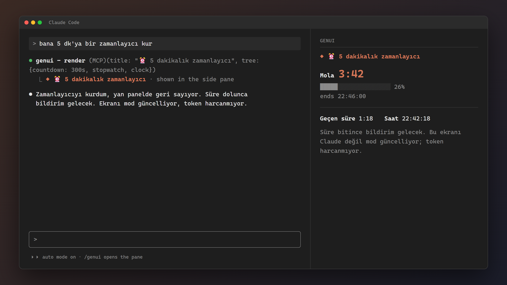
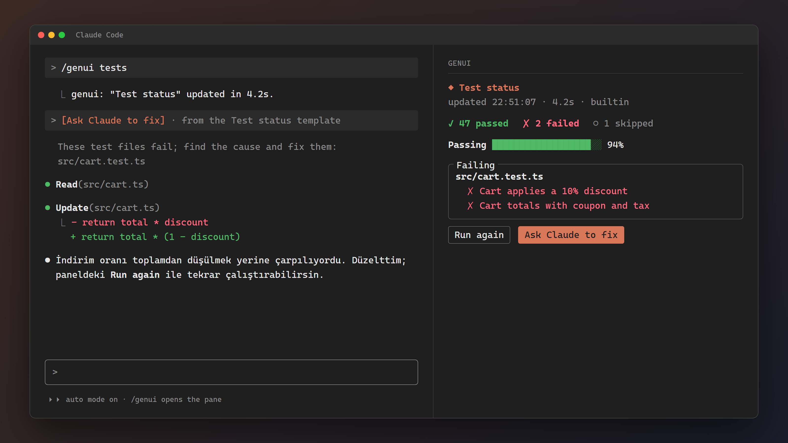
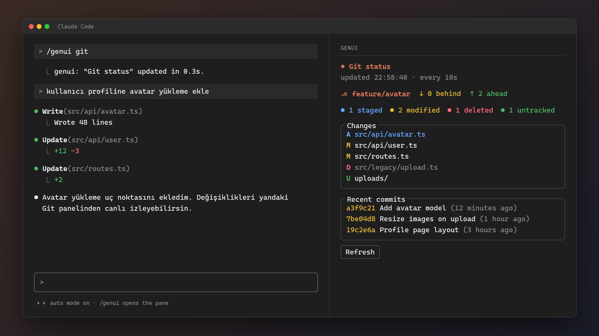

# genui: generative UI for Claude Code

A Claude Code mod that lets Claude draw UI instead of prose: cards, layouts, tables, progress bars, markdown, code, live timers and **forms** whose answers go back to Claude. It also ships **templates**: reusable screens bound to command output, such as live test or git status, that run without Claude and cost no tokens.



## Install

At the prompt of a Claude Code terminal session:

```
/plugin install genui --marketplace emirtuncer/genui-mod
```

Answer `y` to add the marketplace, then pick a scope (user scope is first; press Enter).

From a shell:

```
claude plugin install genui --marketplace emirtuncer/genui-mod
```

In the desktop app, where `/plugin` does not run: click **+** next to the prompt box, then **Plugins**, **Add marketplace** with `emirtuncer/genui-mod`, then **Add plugin**.

## What Claude can draw

Claude calls the `mcp__genui__render` tool with a JSON component tree. Just ask, for example:

- *"set me a 5-minute timer"*
- *"show me a status card for this repo"*
- *"ask me for the settings of a new DB connection with a form"*

The UI is drawn in the GenUI side pane, with a one-line pointer in the transcript. Claude can draw it inline in the transcript instead (`placement: "inline"`), meant for one-off answers. `/genui` opens the side pane. A pane opened without asking needs a wide terminal (about 144 columns); otherwise the UI is drawn inline and `/genui` opens it.

**Nodes:** `box`, `text`, `markdown`, `code`, `link`, `divider`, `table`, `progress`, `kv`, `input`, `select`, `button`. See `hooks/schema.ts` for their fields.

**Live nodes** redraw themselves every second, done by the mod with no script and no tokens: `countdown` (a toast and a notification when it ends), `stopwatch`, `clock`.

**Forms** (`awaitResponse: true`) have live inputs, selects and buttons. A button can:
- `submit`: send the field values;
- `cancel`: send nothing;
- `action`: send its id;
- `prompt`: send its prompt text to Claude without closing the form.

On Submit or Cancel the form locks, and your answers reach Claude as your next message in a `<genui-response>` block.

## Templates: reusable, data-bound screens

| Watching tests | Watching git |
| --- | --- |
|  |  |

A template is a JSON file: commands to run, and a tree whose `{{placeholders}}` are filled from their output. `/genui <name>` runs it and shows it in the side pane, refreshing on a timer if it says so.

```
/genui list          # project, user and built-in templates
/genui tests         # vitest results, with "Run again" and "Ask Claude to fix" (built-in)
/genui git           # branch, ahead/behind, colored changes, recent commits (built-in, every 10 s)
/genui pods          # kubectl pods (built-in, every 10 s)
/genui open <name>   # same as /genui <name>
/genui init git      # copy a built-in template to .claude/genui/git.json to edit it
/genui refresh       # read the shown template's file again and run it
```

The names `list`, `init`, `refresh` and `open` are reserved, so a template cannot use them.

Templates live in two places:
- `.claude/genui/<name>.json`: project templates, shared with your team through git;
- `~/.claude/genui/<name>.json`: your own.

A small one:

```json
{
  "title": "Branch",
  "sources": { "branch": { "argv": ["git", "branch", "--show-current"], "parse": "text" } },
  "refreshSeconds": 10,
  "tree": { "type": "text", "text": "⎇ {{branch | default:—}}", "bold": true, "color": "claude" }
}
```

The full format is in `hooks/schema.ts` (`TEMPLATE_DOC`). It covers:
- sources: `json`, `text`, `lines`, `timeoutMs`, `allowFailure`, `manual`;
- filters: `length`, `first`, `last`, `count`, `where`, `map`, `join`, `sort`, `take`, `split`, `trim`, `upper`, `default`;
- the `each` and `when` nodes;
- `refresh` and `run` buttons.

Claude can write a template for you and check it with its `preview_template` tool.

### Safety

- Commands run as argv, with no shell.
- A project template asks before running its commands the first time, again whenever its commands or prompt texts change, and when it is opened from a different project root. An approval is tied to a SHA-256 fingerprint of what it runs.
- Built-in and user templates run without asking when **you** type `/genui <name>`. They always ask when Claude starts one with `preview_template`.
- A template's prompt button sends its text marked as coming from the template (`<genui-prompt template="…" origin="…">`), not as your own words.

## Develop

```
git clone https://github.com/emirtuncer/genui-mod
claude --plugin-dir ./genui-mod
claude plugin validate ./genui-mod
claude plugin test ./genui-mod
```

### Note on blocking forms

A hook may run for only 10 seconds of its own time, so the tool can't hold the turn open while you fill a form. Instead it returns right away and tells Claude to end its turn. Your answers arrive as the next prompt, so to you the flow looks the same.

## License

MIT
